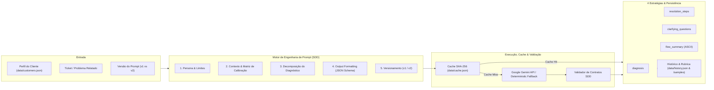

# Assistente de Atendimento ao Cliente com Engenharia de Prompt & Evaluation Harness

Aplicação de suporte técnico personalizado construída com **Specification-Driven Development (SDD)** e um **Prompt Evaluation Harness** para adaptar diagnóstico, passo a passo de resolução, perguntas de esclarecimento e fluxogramas ASCII ao perfil de cada cliente (`nível técnico`, `estilo de comunicação` e `canal de atendimento`).

---

## 1. Arquitetura Resumida



### Estrutura do Repositório

```text
├── .agents/
│   ├── rules/prompt-engineering-guardrails.md  # Guardrails de adaptação ao perfil e rubrica
│   └── skills/prompt-harness-sdd/SKILL.md      # Skill operacional SDD & Evaluation Harness
├── AGENTS.md & GEMINI.md                       # Regras hierárquicas do workspace
├── mcp_config.json                             # Configuração do servidor MCP local
├── specs/                                      # Especificações SDD (Domínio, Prompts, Harness/Cache)
├── data/
│   ├── customers.json                          # 5 perfis de clientes (leigo, intermediário, avançado)
│   ├── tickets.json                            # Tickets de referência para testes e benchmark
│   ├── cache.json                              # Cache determinístico SHA-256
│   └── history.json                            # Histórico completo de execuções com timestamp e rubrica
├── samples/                                    # Exemplos de saída JSON e comparações v1 vs v2 avaliadas
├── src/
│   ├── config/env.js                           # Carregador .env nativo e configurações do modelo
│   ├── schemas/validator.js                    # Validação de contratos SDD e rubrica (1 a 5)
│   ├── prompts/engine.js                       # Motor dinâmico de Engenharia de Prompt (v1 e v2)
│   ├── services/
│   │   ├── cache.js                            # Estratégia de cache SHA-256
│   │   ├── llm.js                              # Cliente HTTP Google Gemini API + fallback determinístico
│   │   ├── generators.js                       # 4 funções geradoras separadas por tipo de conteúdo
│   │   └── storage.js                          # Persistência JSON
│   ├── harness/runner.js                       # Prompt Evaluation Harness (Comparação v1 vs v2 + Rubrica)
│   ├── cli.js                                  # Interface CLI interativa e por argumentos (Obrigatória)
│   ├── web/server.js                           # Interface Web leve opcional (Diferencial)
│   └── mcp/server.js                           # Servidor Model Context Protocol (MCP) via Stdio
├── tests/harness.test.js                       # Testes automatizados SDD (node:test)
├── PROMPT_ENGINEERING_NOTES.md                 # Documentação detalhada das estratégias de prompt e rubrica
├── .env.example                                # Exemplo de variáveis de ambiente (sem chaves reais)
└── package.json                                # Scripts e metadados do projeto (Zero dependências externas)
```

---

## 2. Pré-requisitos e Setup

- **Node.js**: versão `>= 18.0.0` (testado em Node.js `v24`).
- O projeto utiliza **exclusivamente módulos nativos do Node.js** (`node:fs`, `node:crypto`, `node:http`, `node:readline`, `node:test`, `fetch` nativo), evitando dependências desnecessárias e garantindo execução imediata.

### Passo a passo de instalação

1. Clone o repositório e acesse a pasta do projeto:
   ```bash
   git clone <url-do-repositorio>
   cd "teste cin"
   ```

2. Configure o arquivo `.env` a partir do `.env.example`:
   ```bash
   cp .env.example .env
   ```

3. Configure sua chave gratuita do Google AI Studio (`GEMINI_API_KEY`) no arquivo `.env`:
   ```env
   LLM_PROVIDER=gemini
   GEMINI_API_KEY=sua_chave_aqui
   GEMINI_MODEL=gemini-3.8-flash
   LLM_TEMPERATURE=0.2
   ```

---

## 3. Como Executar

### 3.1. Rodar CLI + Interface Web Juntos em um Único Comando
```bash
npm start
# ou:
node src/cli.js
```
Ao rodar `npm start`, o sistema **sobe automaticamente o servidor Web em `http://localhost:3000` em segundo plano e abre o menu interativo da CLI no terminal ao mesmo tempo**.

O menu interativo (e a interface web) permitem:
1. Selecionar um dos **5 perfis de cliente** cadastrados em `data/customers.json`;
2. Selecionar um ticket de exemplo ou digitar um **novo ticket** manualmente;
3. Escolher qualquer um dos **4 tipos de conteúdo** (`diagnosis`, `resolution_steps`, `clarifying_questions`, `flow_summary`) ou gerar todos de uma vez;
4. Selecionar a versão do prompt (`v1` ou `v2`) ou rodar a **Comparação `v1` vs `v2` com Rubrica**;
5. Visualizar a saída formatada (incluindo o fluxograma ASCII) e o caminho exato onde o JSON foi salvo.

### 3.2. Comandos Diretos via CLI (Não-Interativo)

- **Listar perfis de clientes (`data/customers.json`)**:
  ```bash
  node src/cli.js list-profiles
  ```

- **Gerar os 4 tipos de conteúdo para um cliente e ticket**:
  ```bash
  node src/cli.js generate --customer cust_01 --ticket tkt_01 --type all --version v2
  ```

- **Gerar um conteúdo específico (ex: `flow_summary` ou `diagnosis`)**:
  ```bash
  node src/cli.js generate --customer cust_03 --ticket tkt_03 --type flow_summary --version v2
  ```

- **Executar a Comparação Obrigatória `v1` vs `v2` no Harness com a Rubrica de 3 Critérios**:
  ```bash
  npm run harness
  # ou especificando cliente, ticket e tipo:
  node src/cli.js compare --customer cust_01 --ticket tkt_01 --type diagnosis
  ```

- **Gerar/Atualizar todos os exemplos do diretório `/samples`**:
  ```bash
  node src/cli.js seed-samples
  ```

### 3.3. Interface Web Simples (Diferencial / Extra)
```bash
npm run web
```
Acesse `http://localhost:3000` no navegador para interagir visualmente com os perfis, tickets, geração dos 4 conteúdos, verificação de *Cache Hit* e comparação lado a lado (`v1` vs `v2`).

### 3.4. Executar Testes Automatizados SDD
```bash
npm test
```

---

## 4. Exemplos de Saída (`/samples`)

O diretório [`samples/`](./samples/) contém execuções reais geradas na API do Google Gemini (`gemini-3.8-flash`) em JSON:
- [`samples/comparison_cust_01_diagnosis_v1_vs_v2.json`](./samples/comparison_cust_01_diagnosis_v1_vs_v2.json): Comparação controlada entre `v1` e `v2` para `diagnosis` no cenário `cust_01` (Dona Helena - `leigo`/`didático`/`chat`) + `tkt_01` (Erro 502 no pagamento), incluindo as notas de 1 a 5 e justificativas escritas nos 3 critérios da rubrica (`clarity`, `customer_fit`, `actionability`).
- [`samples/full_4_contents_cust_01_v2.json`](./samples/full_4_contents_cust_01_v2.json): Pacote completo com os 4 tipos de conteúdo (`diagnosis`, `resolution_steps`, `clarifying_questions` e `flow_summary` com fluxograma ASCII) gerados pela API do Google Gemini.

Para a explicação aprofundada das estratégias de engenharia de prompt, consulte [`PROMPT_ENGINEERING_NOTES.md`](./PROMPT_ENGINEERING_NOTES.md).

